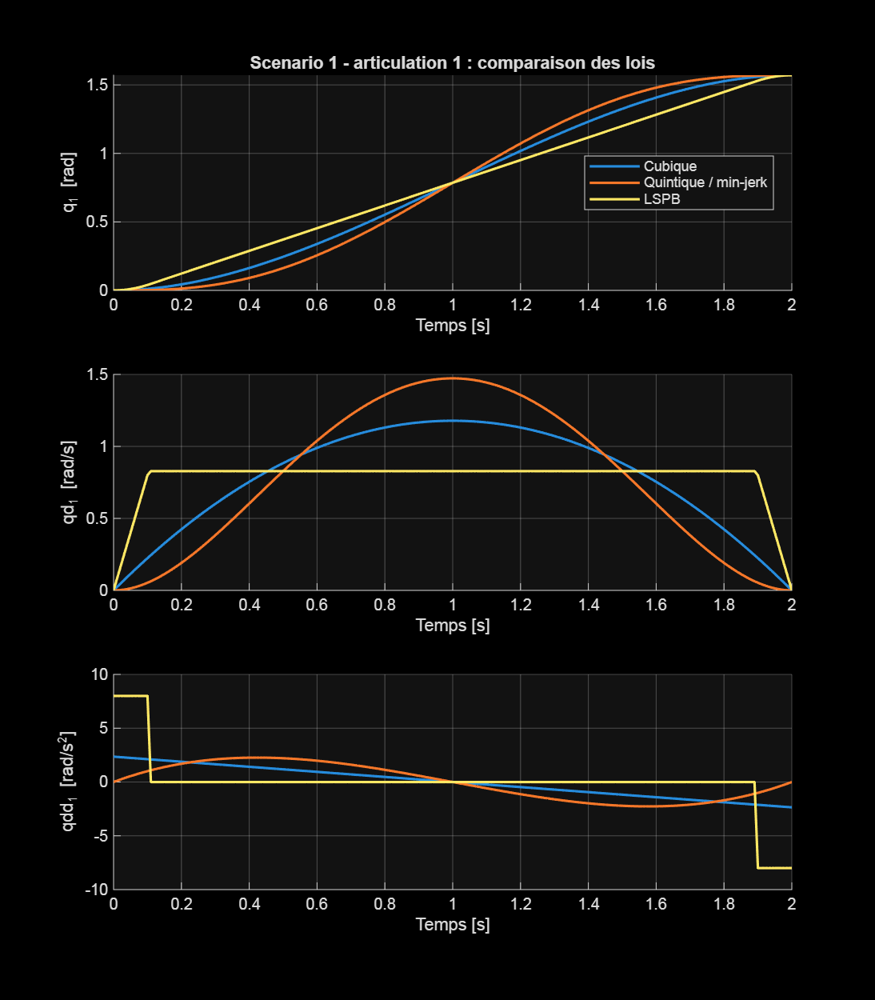
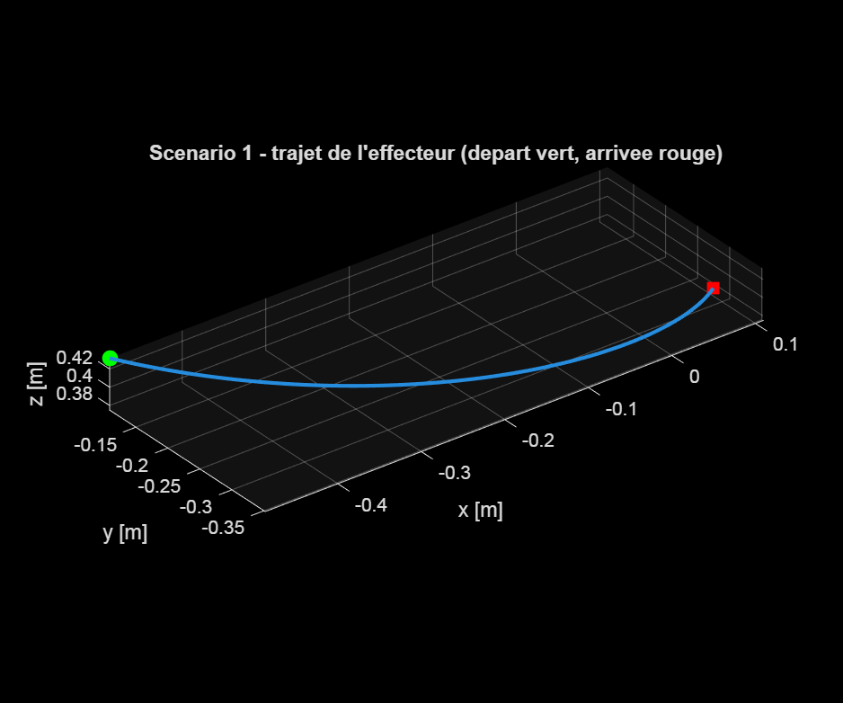
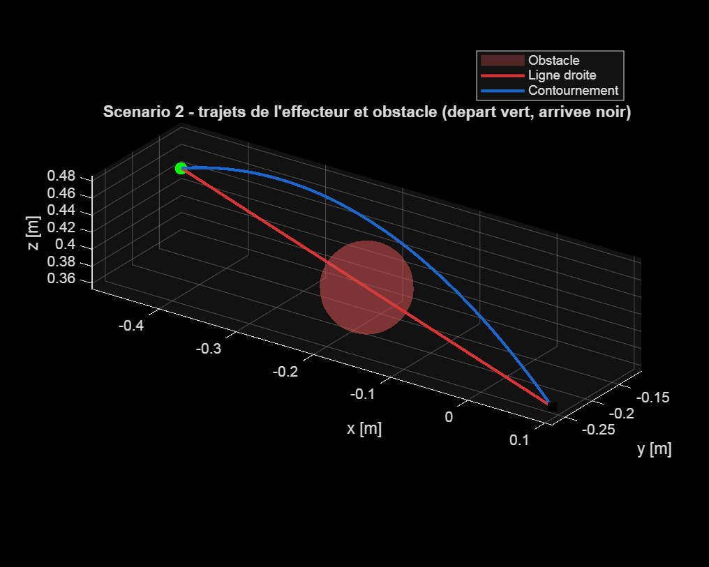
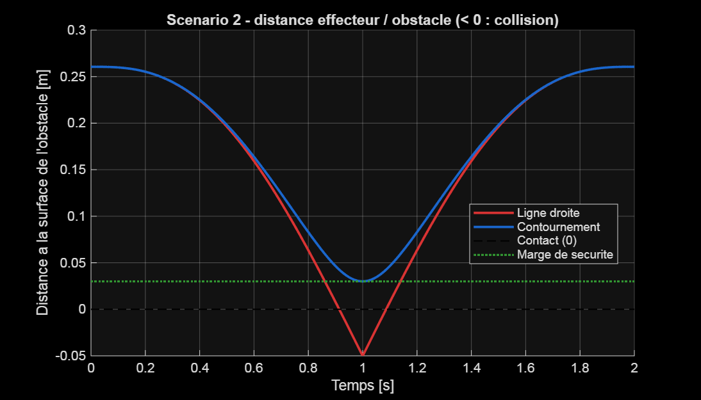
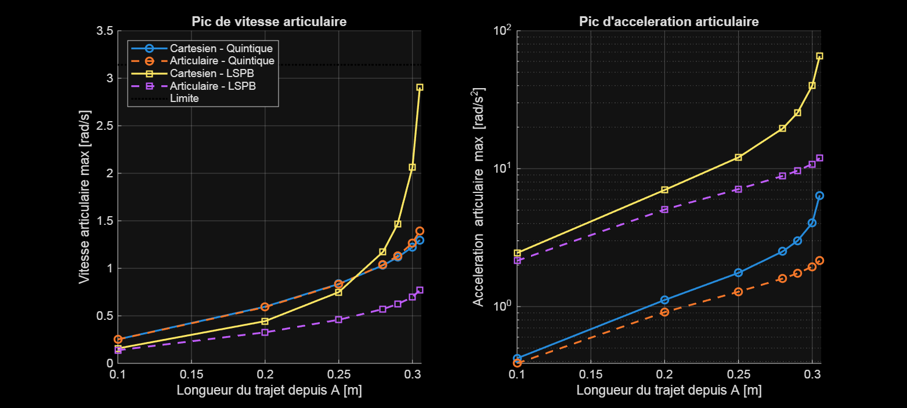
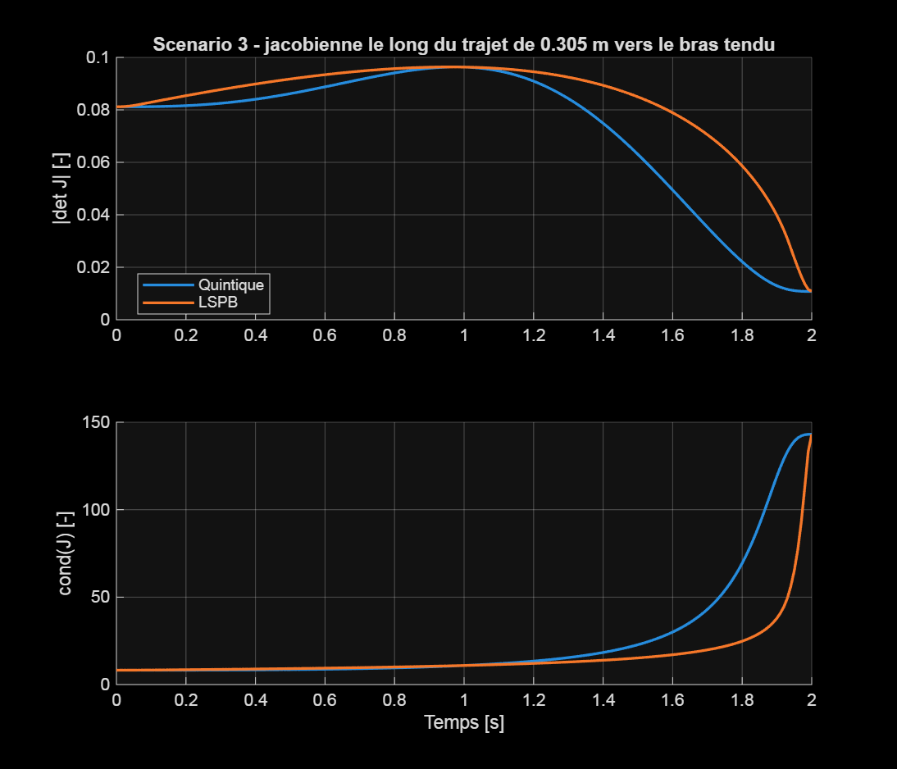

# UR5 Trajectory Planning

**Planification de trajectoire pour le robot manipulateur UR5 sous MATLAB** : comparaison de lois de mouvement, évitement d'obstacle et comportement près d'une singularité.


## Sommaire

1. [Contexte et problématique](#1-contexte-et-problématique)
2. [Prérequis et lancement](#2-prérequis-et-lancement)
3. [Structure du dépôt](#3-structure-du-dépôt)
4. [Modèle du robot](#4-modèle-du-robot)
5. [Méthodes](#5-méthodes)
6. [Résultats](#6-résultats)
7. [Synthèse générale](#7-synthèse-générale)
8. [Limites et perspectives](#8-limites-et-perspectives)
9. [Sources](#9-sources)

---

## 1. Contexte et problématique

Un robot ne peut pas déplacer son effecteur (l'outil au bout du bras) d'un point A à un point B sans qu'on lui dise **par où passer** (le chemin) et **à quelle vitesse** (la loi horaire). L'ensemble forme la **trajectoire**, que le contrôleur reçoit sous forme de positions, vitesses et accélérations articulaires.

> **Problématique** : comment choisir la loi de mouvement et l'espace de planification (articulaire ou cartésien) pour un déplacement point à point d'un UR5, avec ou sans obstacle, en comparant durée, fluidité, précision géométrique et sécurité ?

Trois scénarios, du même point de départ qA vers le même point d'arrivée qB en 2 s :

| N° | Scénario | Question posée |
|---|---|---|
| 1 | Sans obstacle, espace articulaire | Quelle loi de mouvement choisir ? |
| 2 | Avec obstacle, espace cartésien | Comment contourner l'obstacle, et à quel coût ? |
| 3 | Proche d'une singularité | Que devient la trajectoire quand le bras se tend ? |

## 2. Prérequis et lancement

- **MATLAB** : version R2025b
- **Toolboxes** : **aucune**. Le modèle du UR5 et la cinématique inverse sont écrits en MATLAB pur.
- Windows, Linux ou macOS (chemins relatifs uniquement)

```matlab
main                % reproduit toutes les figures et les tableaux
test_trajectoires   % tests des lois de mouvement (valeurs théoriques)
test_modele         % MGD puis MGI : la pose cible doit être retrouvée
test_jacobienne     % jacobienne comparée à une différence finie
```

`main.m` enregistre les figures dans `resultats/`.

## 3. Structure du dépôt

```
.
├── main.m                          Point d'entrée : lance les 3 scénarios
├── params.m                        Tous les paramètres (aucune valeur en dur ailleurs)
├── robot/
│   ├── charger_robot.m             Paramètres DH du UR5
│   ├── fk_ur5.m                    MGD : angles -> position et orientation de l'effecteur
│   ├── ik_ur5.m                    MGI numérique (Damped Least Squares)
│   └── jacobienne_ur5.m            Jacobienne géométrique 6x6
├── trajectoires/
│   ├── traj_cubique.m              Polynôme de degré 3
│   ├── traj_quintique.m            Polynôme de degré 5
│   ├── traj_minjerk.m              Minimum jerk (= quintique en repos-repos)
│   ├── traj_lspb.m                 Profil trapézoïdal
│   ├── bezier2.m                   Courbe de Bézier quadratique 3D
│   └── traj_cartesienne.m          Chemin cartésien + MGI à chaque pas
├── planification/
│   ├── distance_sphere.m           Distance effecteur / obstacle sphérique
│   └── planif_obstacle.m           Contournement : décalage minimal de la courbe
├── analyse/
│   └── indicateurs_traj.m          Vitesse, accélération, jerk, longueur, écart à la droite
├── scenarios/
│   ├── scenario1_sans_obstacle.m
│   ├── scenario2_obstacle.m
│   └── scenario3_singularite.m
├── tests/                          Tests de validation
└── resultats/                      Figures PNG générées par main.m
```

## 4. Modèle du robot

Le UR5 est un bras à **6 articulations rotoïdes**. Son modèle géométrique suit la convention de **Denavit-Hartenberg** (paramètres dans `robot/charger_robot.m`).

- **MGD** (`fk_ur5`) : produit de 6 matrices de transformation homogènes, qui donne la position et l'orientation de l'effecteur à partir des 6 angles.
- **MGI** (`ik_ur5`) : méthode itérative *Damped Least Squares* (Levenberg-Marquardt) avec jacobienne numérique. Elle part de la configuration du pas précédent, ce qui évite les sauts de configuration.
- **Jacobienne** (`jacobienne_ur5`) : matrice 6x6 qui relie les vitesses articulaires aux vitesses de l'effecteur. Quand son déterminant tend vers 0, le robot approche d'une **singularité**.

Validation : MGD(MGI(pose)) redonne la pose avec une erreur d'environ 5e-7 m (`test_modele`), et la jacobienne est comparée à une différence finie (`test_jacobienne`).

## 5. Méthodes

**Lois de mouvement** (départ et arrivée au repos), avec τ = t/T et q = q0 + (qf − q0)·s(τ) :

| Loi | s(τ) | Propriété |
|---|---|---|
| Cubique | 3τ² − 2τ³ | Simple, mais accélération non nulle aux extrémités (à-coups) |
| Quintique / minimum jerk | 10τ³ − 15τ⁴ + 6τ⁵ | La plus douce : accélération nulle aux extrémités |
| LSPB (trapèze) | accélération constante, croisière, décélération | Contrôle direct de l'accélération maximale |

**Espace articulaire** : on interpole les 6 angles. Simple et sans singularité sur le chemin, mais l'effecteur ne suit pas une droite.

**Espace cartésien** : on impose le chemin de l'effecteur (droite ou courbe de Bézier) et la MGI donne les angles à chaque pas.

**Évitement d'obstacle** : obstacle sphérique, contournement par une courbe de Bézier quadratique dont le décalage est le plus petit qui respecte une marge de sécurité.

**Indicateurs** : vitesse, accélération et jerk maximaux, longueur du trajet, écart à la droite A-B, distance à l'obstacle, déterminant et conditionnement de la jacobienne.

---

## 6. Résultats

### Scénario 1 : sans obstacle, espace articulaire

Déplacement de qA à qB en 2 s. L'articulation 1 fait la plus grande rotation (90°) et fixe les maxima.

| Loi | Vitesse max [rad/s] | Accélération max [rad/s²] | Jerk max [rad/s³] | Longueur effecteur [m] |
|---|---|---|---|---|
| Cubique | 1.178 | 2.356 | ≈ 236 | 0.7121 |
| Quintique / min-jerk | 1.473 | 2.267 | 11.6 | 0.7121 |
| LSPB | 0.828 | 8.000 | 800 | 0.7128 |

<p align="center"></p>

*Position, vitesse et accélération de l'articulation 1 pour les trois lois. La quintique démarre et s'arrête sans saut d'accélération ; la cubique et le LSPB ont des sauts.*

<p align="center"></p>

*Trajet 3D de l'effecteur (départ en vert, arrivée en rouge) : en espace articulaire, l'effecteur décrit un arc qui s'écarte de 0.148 m de la droite A-B.*

**À retenir** : la quintique est la plus douce (jerk environ 20 fois plus faible que la cubique) au prix d'un pic de vitesse 25 % plus élevé. Le LSPB respecte directement la limite d'accélération et a le pic de vitesse le plus bas.

### Scénario 2 : avec obstacle, espace cartésien

Une sphère de 5 cm de rayon est placée au milieu de la droite A-B. La droite la traverse ; le contournement l'évite avec une marge de 3 cm.

| Trajet | Longueur [m] | Distance min à l'obstacle [m] | Vitesse max [rad/s] | Collision |
|---|---|---|---|---|
| Ligne droite | 0.6211 | −0.050 | 2.203 | Oui |
| Contournement | 0.6476 | 0.030 | 2.185 | Non |

<p align="center"></p>

*Trajets de l'effecteur et obstacle (sphère) : la ligne droite passe par le centre de la sphère, le contournement la dépasse par le haut.*

<p align="center"></p>

*Distance entre l'effecteur et la surface de l'obstacle au cours du temps : négative pour la droite (collision), toujours au-dessus de la marge de sécurité pour le contournement.*

**À retenir** : éviter l'obstacle coûte 2.6 cm de trajet en plus (+4 %). Les vitesses articulaires atteignent 2.2 rad/s en cartésien, contre 1.47 rad/s en articulaire (scénario 1) pour la même durée : imposer le trajet de l'effecteur demande davantage aux moteurs.

### Scénario 3 : approche d'une singularité (bras tendu)

Trajet rectiligne depuis A vers le **bras tendu** (articulation 3 tendant vers 0), atteint à environ 0.306 m de A. Pour chaque longueur de trajet, la **même loi horaire** est appliquée dans les deux espaces (cartésien et articulaire), ce qui isole l'effet de l'espace de planification.

Pour la cible la plus proche de la singularité (trajet de 0.305 m) :

| Indicateur | Au départ (A) | Près de la singularité |
|---|---|---|
| \|det J\| | 0.0812 | 0.0108 |
| cond(J) | 8.2 | 143 |

| Loi | Vitesse max cartésien | Vitesse max articulaire | Accélération max cartésien | Accélération max articulaire |
|---|---|---|---|---|
| Quintique | 1.298 rad/s | 1.396 rad/s | 6.405 rad/s² | 2.148 rad/s² |
| LSPB | 2.903 rad/s | 0.769 rad/s | 65.43 rad/s² | 11.91 rad/s² |

<p align="center"></p>

*Pic de vitesse et pic d'accélération articulaires en fonction de la longueur du trajet : les courbes cartésiennes (traits pleins) s'écartent des courbes articulaires (tirets) à l'approche de la singularité.*

<p align="center"></p>

*Déterminant et conditionnement de la jacobienne le long du trajet de 0.305 m : le déterminant chute et le conditionnement augmente fortement quand le bras se tend.*

**À retenir** :
- Près d'une singularité, imposer un trajet rectiligne à l'effecteur demande beaucoup plus aux moteurs qu'une interpolation articulaire.
- Avec la **quintique**, la loi ralentit à l'arrivée et le pic de vitesse reste raisonnable, mais l'**accélération** articulaire est multipliée par 3 par rapport à l'espace articulaire.
- Avec le **LSPB** (vitesse constante jusqu'au dernier moment), la **vitesse** articulaire est multipliée par 3.8 et approche la limite de π rad/s : le choix de la loi compte autant que celui de l'espace.
- Pour une cible exactement singulière ou hors espace de travail, la MGI échoue.

---

## 7. Synthèse générale

| Critère | Scénario 1 (articulaire) | Scénario 2 (cartésien) | Scénario 3 (singularité) |
|---|---|---|---|
| Trajet de l'effecteur | Arc (écart 0.148 m) | Imposé (droite ou courbe) | Imposé (droite) |
| Vitesse articulaire max | 0.83 à 1.47 rad/s | 2.2 rad/s | 1.3 à 2.9 rad/s |
| Évitement d'obstacle | Non | Oui | Non |
| Risque principal | Trajet non rectiligne | Vitesses articulaires élevées | Vitesses et accélérations qui explosent |

1. **Aucune méthode n'est la meilleure** : le choix dépend du compromis entre rapidité, douceur, précision géométrique et sécurité.
2. **L'espace articulaire** est simple et sûr, mais l'effecteur ne suit pas une droite.
3. **L'espace cartésien** impose le trajet de l'effecteur, mais demande plus aux moteurs et dépend de la MGI.
4. **La quintique (minimum jerk)** est la loi la plus douce ; le **LSPB** convient quand une limite d'accélération doit être respectée strictement.

## 8. Limites et perspectives

**Limites**
- Le LSPB multi-axes du scénario 1 n'est pas parfaitement synchronisé : chaque articulation calcule sa propre durée d'accélération (longueur 0.7128 m contre 0.7121 m pour les autres lois).
- Seul le point de l'effecteur est testé contre l'obstacle, pas les segments du bras.
- Le contournement est géométrique (obstacle unique, sphérique et connu).
- Seule la singularité du coude (bras tendu) est étudiée, pas celles du poignet ni de l'épaule.
- Les accélérations et jerks sont obtenus par dérivation numérique et dépendent du pas de temps `dt` pour les lois à accélération discontinue.
- Les résultats valent pour le UR5 et les configurations testées.

**Perspectives** : planificateur général (RRT, champs de potentiel), test de collision sur tous les segments, interpolation d'orientation par quaternions, synchronisation du LSPB multi-axes, passage près d'une singularité du poignet.

## 9. Sources

- **Article de référence** : *Trajectory Planning for Robot Manipulators*.
- **Paramètres DH du UR5** : documentation technique de Universal Robots.
- **Assistant IA** : Claude (Anthropic) a été utilisé comme aide à la conception et à la rédaction du code (lois de trajectoire, MGD / MGI, jacobienne, scénarios). Le code a été relu, testé et est compris.